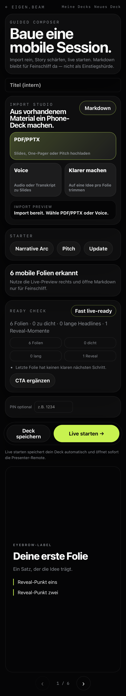
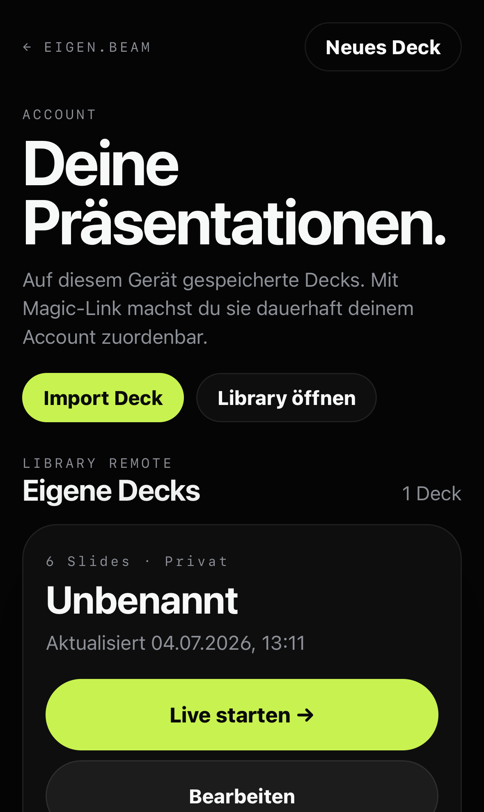

# eigen.beam

> Mobile Live-Sync-Präsentationen: Der Presenter steuert, das Publikum folgt live auf den eigenen Phones.

[](https://github.com/onetechgroupll/eigen-beam/actions/workflows/ci.yml)
[](https://github.com/onetechgroupll/eigen-beam/actions/workflows/production-watchdog.yml)

**Live:** https://eigen-beam-production.up.railway.app

**Stack:** SvelteKit · Svelte 5 · TypeScript · Bun · SSE · Railway · Postgres · S3/Railway Buckets · Resend · MCP

`eigen.beam` turns every audience phone into a synced mini-projector. A presenter controls the current slide from a mobile-first remote; viewers join via link/QR and stay synced over Server-Sent Events without installing an app or logging in.

## What this looks like

| Presenter remote | Viewer live |
|---|---|
|  |  |

| Authoring + Ready Check | Replay command center |
|---|---|
|  |  |

| Library remote |
|---|
|  |

## Product highlights

- **Phone-native live presentation flow** — presenter remote, zero-friction viewer join, 9:16 content-first slides.
- **Live sync via SSE** — server pushes current slide/reveal state; presenter actions are simple POSTs.
- **Mobile authoring** — Markdown, templates, PDF/PPTX import, voice-to-slides, live preview.
- **Ready Check / Deck Quality Coach** — deterministic mobile-live heuristics and safe quick fixes before launch.
- **Audience signals** — reactions, questions, bookmarks, presence, reopen rate and presenter feed.
- **Replay + follow-up** — replay page, session summary, heatmap, coach checklist, follow-up pack and deck-v2 draft.
- **Accounts and sharing** — Magic-Link sessions, private/link/team deck visibility, protected PIN rooms.
- **AI/MCP integration** — remote MCP endpoint for creating/updating decks, uploading assets and starting viewer rooms.
- **Production ops** — health/readiness endpoints, CI smoke gates, manual Mobile QA Lab and production watchdog.

## Use cases

- Screenless customer pitches in offices, offsites or restaurant backrooms.
- Quick internal sales/product updates where everyone has a phone but no projector.
- AI-assisted mini-decks created through MCP and launched as a room.
- Post-session follow-up with replay, heatmap and a better second version of the deck.
- Field-testing whether a story lands before investing in a polished slide deck.

## Quick start

Requirements:

- Bun 1.3.x
- Node compatible with the current SvelteKit adapter-node build
- Playwright browsers for browser/mobile QA when running smoke tests

```bash
bun install
bun run doctor
bun run docs:check
bun run check
bun run build
bun run dev
```

Open the local app printed by Vite and start a live session from the home page.

## See it work in 90 seconds

1. Run `bun run dev`.
2. Open the local URL.
3. Click **Live-Sync testen**.
4. Open the viewer link on a second browser window or phone.
5. Tap **Weiter** on the presenter remote.
6. Watch the viewer stay in sync.

For a production-like local proof, use the smoke flow below and run `bun run smoke:browser`.

## Canonical commands

| Purpose | Command |
|---|---|
| Install | `bun install` |
| Local environment doctor | `bun run doctor` |
| Documentation check | `bun run docs:check` |
| Typecheck | `bun run check` |
| Repository verification | `bun run verify:c1a` |
| Build | `bun run build` |
| Start production build | `bun run start` |
| Browser smoke | `bun run smoke:browser` |
| Replay smoke | `bun run smoke:replay` |
| Ops smoke | `bun run smoke:ops` |
| MCP smoke | `bun run smoke:mcp` |
| Mobile QA Lab | `bun run qa:mobile` |
| DB migrations | `bun run db:migrate` |

For local production smoke testing:

```bash
rm -rf build .svelte-kit/output .svelte-kit/generated
bun run build
ORIGIN=http://127.0.0.1:4316 \
EB_MAGIC_LINK_SECRET=local-smoke-secret \
EB_DATA_DIR=.data/ci-smoke \
EB_DECK_STORE=file \
EB_ACTIVITY_STORE=off \
EB_MAIL_PROVIDER=outbox \
PORT=4316 HOST=127.0.0.1 \
node build
```

Then, in another shell:

```bash
EB_SMOKE_BASE=http://127.0.0.1:4316 bun run smoke:browser
EB_SMOKE_BASE=http://127.0.0.1:4316 bun run smoke:replay
EB_SMOKE_BASE=http://127.0.0.1:4316 bun run smoke:ops
```

## Architecture at a glance

```text
Presenter phone ── POST /present/:id/slide ──▶ SvelteKit server
Viewer phones   ◀─ SSE /v/:id/stream ───────── In-memory live room
Presenter phone ◀─ SSE /present/:id/events ─── Audience signals

Durable data: Postgres decks/replay/follows
Assets: Railway Buckets / S3-compatible store
Mail: Resend in production, outbox locally
AI clients: /mcp over bearer/OAuth-compatible auth
```

Key decisions:

- **SSE, not WebSockets.** The live flow is asymmetric: server streams to viewers/presenter, clients POST mutations.
- **Live rooms are in-memory.** Deploy/restart ends active sessions; do not deploy during a live presentation.
- **Presenter control uses httpOnly cookies.** Presenter tokens are never placed in viewer URLs or MCP responses.
- **Public payloads are serialized.** Viewer/replay/share/export surfaces strip presenter-only fields such as `speakerNotes` and raw source.
- **AI/import is off the live path.** Expensive transformations happen before a session starts.

## Design principles

- **Content first.** Chrome should never compete with the slide.
- **Zero join friction.** Link/QR, no app install, no viewer login, no name entry.
- **Live sync is the product.** If people can just read ahead like a PDF, the differentiator is gone.
- **Phone-native, not desktop squeezed down.** 9:16 layouts, thumb targets and safe areas are first-class.
- **Live layer stays lightweight.** Signals help the presenter; they do not turn the viewer into a dashboard.

## Documentation map

Start here:

- [`docs/index.md`](docs/index.md) — documentation index and reading paths.
- [`docs/development.md`](docs/development.md) — first-10-minutes setup, local loop and CI-credit discipline.
- [`docs/scripts.md`](docs/scripts.md) — script reference and common env vars.
- [`docs/editor-and-agent-setup.md`](docs/editor-and-agent-setup.md) — Claude/Hermes/MCP/editor setup.
- [`docs/fixtures.md`](docs/fixtures.md) — committed examples and fixture usage.
- [`docs/architecture.md`](docs/architecture.md) — system diagram, live-room model and auth boundaries.
- [`docs/testing.md`](docs/testing.md) — local, CI and mobile QA verification.
- [`docs/deployment.md`](docs/deployment.md) — Railway deployment and production configuration.
- [`docs/security.md`](docs/security.md) — public surfaces, invariants and reporting process.
- [`docs/privacy.md`](docs/privacy.md) — data-use and privacy notes.
- [`docs/troubleshooting.md`](docs/troubleshooting.md) — common local, CI, Railway, MCP and WebKit issues.
- [`docs/qa.md`](docs/qa.md) — curated screenshot assets and manual QA checklist.
- [`docs/eigenbeam-ops.md`](docs/eigenbeam-ops.md) — health/readiness and watchdogs.
- [`docs/eigenbeam-mcp.md`](docs/eigenbeam-mcp.md) — remote MCP endpoint and tools.
- [`docs/eigenbeam-mcp-claude-setup.md`](docs/eigenbeam-mcp-claude-setup.md) — Claude Code project setup.
- [`docs/eigenbeam-design-2026-06-28.md`](docs/eigenbeam-design-2026-06-28.md) — product and architecture rationale.
- [`docs/eigenbeam-roadmap-2026-06-28.md`](docs/eigenbeam-roadmap-2026-06-28.md) — implementation status and roadmap history.

Tutorials and examples:

- [`docs/tutorials/manual-live-session.md`](docs/tutorials/manual-live-session.md)
- [`docs/tutorials/import-to-live-room.md`](docs/tutorials/import-to-live-room.md)
- [`docs/tutorials/mcp-create-and-launch.md`](docs/tutorials/mcp-create-and-launch.md)
- [`docs/tutorials/replay-to-follow-up.md`](docs/tutorials/replay-to-follow-up.md)
- [`examples/`](examples/) — demo decks and MCP payload examples.

## GitHub Actions

- **CI** (`.github/workflows/ci.yml`) runs on push/PR: docs check; for app changes also typecheck, repo verification, build, local production server, browser/replay/ops smokes.
- **Mobile QA Lab** (`.github/workflows/mobile-qa.yml`) is manual and uploads mobile screenshots/reports.
- **Production Watchdog** (`.github/workflows/production-watchdog.yml`) runs on a credit-conscious schedule against health/readiness/OAuth metadata and can be triggered manually.

## Production notes

Production runs on Railway at the live URL above. Required durable production modes are documented in [`docs/deployment.md`](docs/deployment.md) and [`docs/eigenbeam-ops.md`](docs/eigenbeam-ops.md).

Important operating rule:

> Do not deploy/restart while a real live presentation is running. Active live rooms are intentionally in-memory and will be lost on restart.

## Privacy and data

- Viewer events are designed around counts/types rather than PII.
- Public replay/share/export surfaces must not expose presenter tokens, raw source, owner IDs or speaker notes.
- Import/AI paths may process user content and require a signed user session in production.
- MCP tools require bearer/OAuth auth; `create_room` returns viewer/replay links only.

See [`docs/privacy.md`](docs/privacy.md) and [`docs/security.md`](docs/security.md).

## FAQ

### Why SSE and not WebSockets?

The live model is asymmetric: clients POST mutations, the server streams state. Native `EventSource` reconnect behavior is enough and keeps the live layer simpler.

### What happens during a deploy?

Active live rooms end because room state is in-memory. Decks, replays and follows remain durable when production is configured with Postgres.

### Can viewers skip ahead?

The viewer is designed around the presenter-controlled live index. The goal is social sync, not DRM.

### Does the audience need an account?

No. Viewer join is link/QR based. Accounts are for creators managing saved decks.

### Can AI clients create decks?

Yes. The hosted MCP endpoint exposes authenticated tools for deck create/read/update, asset upload and viewer-room creation.

### Where are speaker notes visible?

Speaker notes are presenter-only and stripped from public viewer/replay/share/export payloads.

## Repository status

eigen.beam is open source under the [MIT License](LICENSE), built by [Lucas Lingens](https://github.com/onetechgroupll). Issues and PRs are welcome; see [`CONTRIBUTING.md`](CONTRIBUTING.md). Report vulnerabilities privately as described in [`SECURITY.md`](SECURITY.md).
