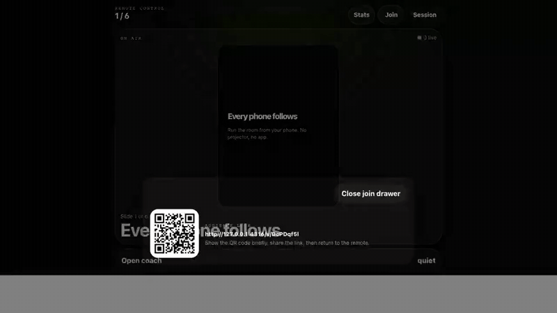
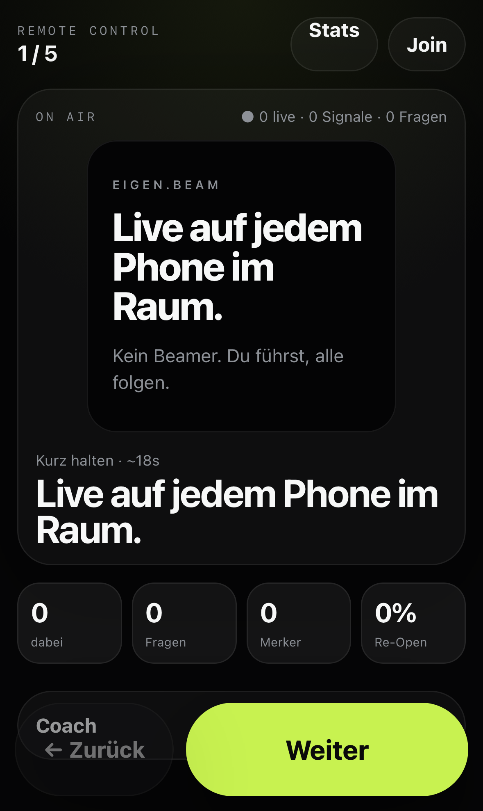
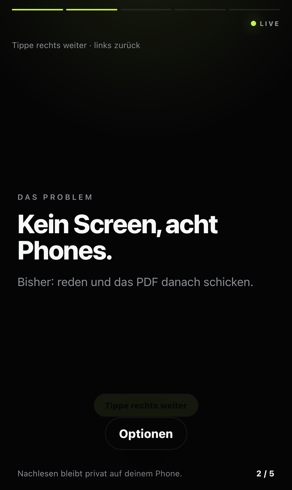

<a href="https://github.com/onetechgroupll/eigen-beam">
  <picture>
    <source media="(prefers-color-scheme: dark)" srcset="./docs/assets/readme/header-dark.svg">
    
  </picture>
</a>

<p align="center">
  <a href="https://eigen-beam-production.up.railway.app"><picture><source media="(prefers-color-scheme: dark)" srcset="./docs/assets/readme/btn-demo-dark.svg"></picture></a>
  <a href="docs/deployment.md"><picture><source media="(prefers-color-scheme: dark)" srcset="./docs/assets/readme/btn-selfhost-dark.svg"></picture></a>
  <a href="docs/index.md"><picture><source media="(prefers-color-scheme: dark)" srcset="./docs/assets/readme/btn-docs-dark.svg"></picture></a>
  <br>
  <a href="https://github.com/onetechgroupll/eigen-beam/actions/workflows/ci.yml"></a>
  <a href="LICENSE"></a>
</p>

**eigen.beam turns every phone in the room into a synced projector.** You present from a mobile remote; the audience joins by link or QR code and follows your slides live on their own phones. No app, no login, no beamer.

It is built for the meetings where there is no screen: client pitches, offsites, standing updates, restaurant backrooms. A PDF sent afterwards cannot make everyone look at the same slide while you talk. eigen.beam can.

<p align="center">
  
</p>

> [!NOTE]
> The app UI is available in **English and German**. It follows the browser language by default, and the persistent language switcher is available in the footer and account area. Deck content is never translated.

### What it does

<picture>
  <source media="(prefers-color-scheme: dark)" srcset="./docs/assets/readme/features-dark.svg">
  
</picture>

- **Live sync that holds.** The presenter controls the slide; viewers are locked to it and can only browse back. Late joiners and dropped connections resync instantly.
- **Authoring on the phone.** Markdown with `---` slide breaks, templates, PDF/PPTX import, voice-to-slides, block types (big number, quote, compare, timeline) and progressive reveal.
- **Ready Check.** Deterministic mobile-readability heuristics with one-tap fixes before you go live.
- **Audience signals.** Reactions, questions and bookmarks reach the presenter without cluttering the viewer screen.
- **Replay and follow-up.** Session summary, per-slide heatmap, follow-up pack and a draft deck v2 built from what landed.
- **Accounts and sharing.** Magic-link sign-in, private/link/team decks and PIN-protected rooms.
- **AI clients via MCP.** A remote MCP endpoint lets Claude and other clients create decks, upload images and start rooms.

### See it

| Presenter remote | Viewer, live | Replay |
|---|---|---|
|  |  |  |

### Quickstart

<picture>
  <source media="(prefers-color-scheme: dark)" srcset="./docs/assets/readme/quickstart-dark.svg">
  
</picture>

```bash
git clone https://github.com/onetechgroupll/eigen-beam && cd eigen-beam
bun install
bun run dev
```

Open the printed URL, tap **Live-Sync testen**, then open the viewer link in a second window. To join from real phones on the same Wi-Fi, start the server with `bun run dev -- --host` and use your machine's LAN address. Tap **Weiter** on the presenter remote and watch the viewer follow.

Local development needs no database and no API keys: decks are stored as files under `.data/`, mail goes to a local outbox.

**Run it with Docker:**

```bash
docker build -t eigen-beam .
docker run -p 3000:3000 -v eigenbeam-data:/data -e ORIGIN=http://localhost:3000 eigen-beam
```

**First login with Docker Compose:**

```bash
export EB_MAGIC_LINK_SECRET="$(openssl rand -hex 32)"
docker compose up -d
# Open http://localhost:3000/account and request a login link, then:
docker compose logs -f eigen-beam
```

Open the URL on the highlighted `=== LOGIN LINK ===` line and start creating decks. [`compose.yaml`](compose.yaml) builds the image from your checkout, includes Postgres, MinIO and persistent volumes, runs migrations on boot and binds to `127.0.0.1` by default (`EB_BIND` overrides). Once releases are published, switch the `image:` line to an immutable tag like `ghcr.io/onetechgroupll/eigen-beam:v0.1.0` and drop the `build:` line. Before exposing the stack publicly, set real secrets and follow the [self-hosting guide](docs/deployment.md).

**Use MCP clients:**

The local Bearer-authenticated endpoint is `http://localhost:4176/mcp`. Create one token for the server and the client wrapper, then register that wrapper with Claude Code:

```bash
mkdir -p .data/secrets
export EB_MCP_TOKEN="$(openssl rand -hex 32)"
printf '%s' "$EB_MCP_TOKEN" > .data/secrets/eigenbeam-mcp-token.txt
printf '%s\n' 'http://localhost:4176/mcp' > .data/secrets/eigenbeam-mcp-url.txt
claude mcp add eigenbeam -- ./scripts/eigenbeam-mcp.sh
EB_MCP_TOKEN="$EB_MCP_TOKEN" bun run dev -- --port 4176
```

`EB_MCP_URL` overrides the URL file for another instance. The wrapper sends `EB_MCP_TOKEN` as a Bearer token and keeps it out of `.mcp.json`; see the [Claude Code setup](docs/mcp-claude-code.md) and [MCP reference](docs/mcp.md).

### How it works

```text
Presenter phone ── POST /present/:id/slide ──▶ SvelteKit server (adapter-node)
Viewer phones   ◀─ SSE  /v/:id/stream ──────── in-memory live room
Presenter phone ◀─ SSE  /present/:id/events ── audience signals

Durable data: Postgres or local files · Assets: S3-compatible or local files
```

- **SSE, not WebSockets.** The flow is asymmetric, and `EventSource` reconnects on its own. ([ADR 0001](docs/adr/0001-sse-not-websockets.md))
- **Live rooms are in-memory.** One fast process, no DB hit per viewer event. A restart ends active sessions, so don't deploy mid-talk. ([ADR 0002](docs/adr/0002-in-memory-live-rooms.md))
- **Presenter control lives in an httpOnly cookie.** It never appears in a viewer URL or an MCP response. ([ADR 0003](docs/adr/0003-presenter-auth-httponly-cookie.md))
- **Content first.** Chrome whispers, the slide talks. ([ADR 0004](docs/adr/0004-content-first-mobile-design.md))

More in [`docs/architecture.md`](docs/architecture.md) and the [ADR index](docs/adr/README.md).

### Stack

<p>
  
  
  
  
  
  
  
  
</p>

### Documentation

| I want to… | Read |
|---|---|
| write a deck and present it | [`docs/deck-syntax.md`](docs/deck-syntax.md), [`docs/live-sessions.md`](docs/live-sessions.md), [how-tos](docs/index.md#how-to-guides) |
| script it over HTTP | [`docs/http-api.md`](docs/http-api.md) |
| run it locally and make changes | [`docs/development.md`](docs/development.md), [`docs/scripts.md`](docs/scripts.md) |
| host my own instance | [`docs/deployment.md`](docs/deployment.md), [`docs/operations.md`](docs/operations.md) |
| understand the design | [`docs/architecture.md`](docs/architecture.md), [`docs/adr/`](docs/adr/README.md), [`docs/design-system.md`](docs/design-system.md) |
| connect Claude or another MCP client | [`docs/mcp.md`](docs/mcp.md), [`docs/mcp-claude-code.md`](docs/mcp-claude-code.md) |
| test and verify | [`docs/testing.md`](docs/testing.md), [`docs/qa.md`](docs/qa.md) |
| review security and privacy | [`docs/security.md`](docs/security.md), [`docs/privacy.md`](docs/privacy.md) |
| see what's next | [`ROADMAP.md`](ROADMAP.md), [`CHANGELOG.md`](CHANGELOG.md) |

Tutorials: [your first deck](docs/tutorials/first-deck.md) · [first live session](docs/tutorials/manual-live-session.md) · [import to live room](docs/tutorials/import-to-live-room.md) · [create and launch via MCP](docs/tutorials/mcp-create-and-launch.md) · [replay to follow-up](docs/tutorials/replay-to-follow-up.md)

### FAQ

**Can viewers skip ahead?** No, the viewer is locked to the presenter's slide and can only browse back. This is a social default, not DRM: the client has the slides it has already seen.

**Does the audience need an account?** No. Viewers join by link or QR code. Accounts are only for presenters who want to save and share decks.

**What happens during a deploy?** Active rooms end because live state is in-memory. Decks, replays and follows survive when you run with Postgres.

**Where are speaker notes visible?** Only on the presenter remote. Viewer, replay, share and export payloads strip them.

**Is the hosted demo stable?** It is the maintainer's own instance and gets redeployed without notice. Rooms end on every deploy. For anything that matters, self-host.

### Contributing

Issues and pull requests are welcome. Start with [`CONTRIBUTING.md`](CONTRIBUTING.md); [good first issues](https://github.com/onetechgroupll/eigen-beam/labels/good%20first%20issue) are labelled. Please report vulnerabilities privately as described in [`SECURITY.md`](SECURITY.md).

### License

[MIT](LICENSE) © Lucas Lingens. Graphics use [Geist](https://vercel.com/font) and [Space Mono](https://fonts.google.com/specimen/Space+Mono) (SIL OFL); regenerate them with `python3 tools/readme/build.py`.
